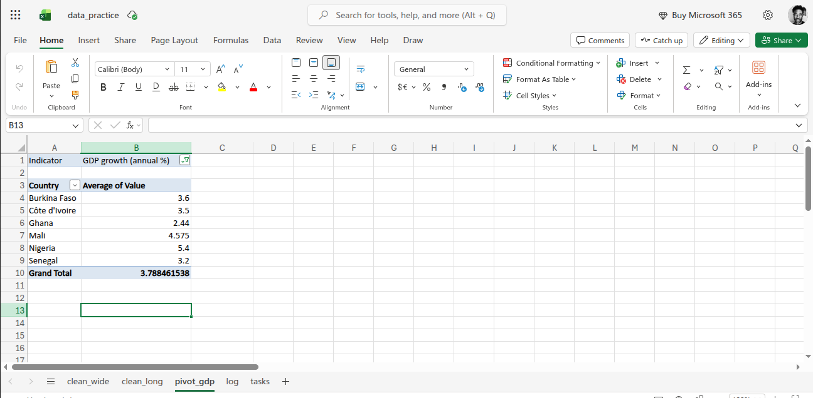

# Data Cleaning Practice: Messy Indicators Dataset

Practice project: cleaning a deliberately messy dataset in Excel, reshaping it
and summarising it with a pivot table.

> **Note:** the dataset is synthetic. It was generated for this exercise and
> styled like a World Bank download, so the numbers are NOT real figures.

## Goal
Turn a messy table of development indicators (6 West African countries,
4 indicators, 2018 to 2023) into clean data that can be analysed.

## Problems in the raw data
- Title rows above the header and notes at the bottom
- Blank rows and 2 duplicate rows
- Country names with extra spaces and different spellings
- Indicator names written in several ways
- ".." and "n/a" used for missing values
- Numbers stored as text (with % signs and commas)
- A header with a hidden space ("2019 ")
- Invisible tab characters in 2 cells

## What I did
1. Removed title rows, notes, blank rows and duplicates (28 to 24 rows)
2. Standardised country and indicator names
3. Replaced ".." and "n/a" with empty cells
4. Converted text numbers into real numbers
5. Reshaped from wide to long format (116 rows) with the TOCOL formula,
   since Power Query is not available in Excel for the web
6. Built a pivot table of average GDP growth by country
7. Documented every change in a log sheet

## Result
| Country | Average GDP growth (%) |
|---|---|
| Burkina Faso | 3.6 |
| Côte d'Ivoire | 3.5 |
| Ghana | 2.44 |
| Mali | 4.58 |
| Nigeria | 5.4 |
| Senegal | 3.2 |

**Caveat:** Côte d'Ivoire's average rests on only 2 years of data, so it is
less reliable than countries with 5 years.

## Files
- `clean_data_practice.xlsx`: cleaned data, pivot table and change log
- `raw_data_practice.xlsx`: original messy file

## Tools
Excel (web): Find and Replace, TRIM, Remove Duplicates, TOCOL, PivotTable

## What I learned
[2 or 3 sentences in your own words]
